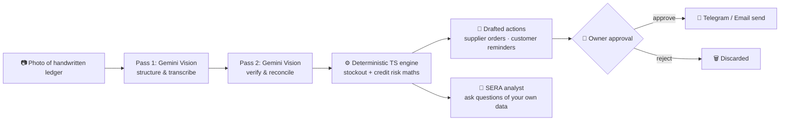

<!--
╔═══════════════════════════════════════════════════════════════╗
║  VNA-07  ·  Ayanda Ross                                       ║
║  "Surviving Rhodes University, one segfault at a time."       ║
║  BSc = Basically Spending Cash on caffeine.                   ║
╚═══════════════════════════════════════════════════════════════╝
-->

<p align="center">
  
</p>

<p align="center">
  <a href="https://vna-07.github.io"></a>
</p>

<p align="center">
  
</p>

<p align="center">
  <a href="https://vna-07.github.io"></a>
  <a href="mailto:avianrossi@gmail.com"></a>
  <a href="https://linkedin.com/in/avian-ross-4b7b31236"></a>
  <a href="https://vna-07.github.io/v-chess/"></a>
</p>

<p align="center">
  
  
  
</p>

<p align="center">
  <b>🥇 Rhodes DevSoc Hackathon 2026 Winner</b> &nbsp;·&nbsp;
  <b>🥈 FNB DataQuest 2026, National 2nd</b> &nbsp;·&nbsp;
  <b>💼 EY Training Contract (Technology/Data)</b> &nbsp;·&nbsp;
  <b>🎓 3.8 GPA, Top 10%</b>
</p>

---

## 🧠 The VNA-07 Ethos

> *"Debugging is like being a detective in a crime movie where you are also the murderer."*

I'm **Ayanda Ross**, a penultimate-year BSc student at **Rhodes University** (Makhanda), majoring in **Computer Science, Statistics & Information Systems**. I build software at the messy intersection of **data intelligence**, **quantitative finance**, **secure systems** and **user experience**, with a bias towards products that matter in the South African context: informal traders, township retailers, credit access, and civic participation.

- 🎓 **BSc @ Rhodes**: CS + Statistics + Information Systems, **3.8 GPA, top 10% of cohort**
- 🥇 **Winner**: Rhodes DevSoc Hackathon 2026, **SEER** (Technical Lead)
- 🥈 **2nd Place nationally**: FNB DataQuest 2026, fairness-audited credit scoring
- 💼 **EY Training Contract** (technology/data track)
- 🔐 Building secure, compliant systems (POPIA-aware, because I like sleeping at night)
- 📊 Quant mindset: if a strategy can't survive **walk-forward validation**, it doesn't ship
- 🧑🏾‍🏫 **Maths tutor** with Nine Tenths Matric Mentoring: I teach what I build on
- 🗣️ **Trilingual**: English, isiXhosa, Afrikaans (learning Setswana & Sepedi)
- ♟️ I coded my ego into a chess AI. **Think you can beat me?** [Play "V" here](https://vna-07.github.io/v-chess/)

---

## 🎯 Currently

| | |
| :--- | :--- |
| 🔭 **Shipping** | [SEER](https://seer-silk.vercel.app/), an early-warning system for township retailers |
| 🛡️ **Competing** | **HackSecure 2026** (CyberM8 · DCDT · GIZ · UJ) with **VERA**, a verifiable digital-forensics & evidence-attestation platform |
| 🌍 **Next up** | "Africa's biggest hackathon", plus the Alpaca AI Trading Agents Hackathon |
| 🌱 **Exploring** | Fairness & explainability in credit models, document-vision pipelines, options/volatility strategies, applied cryptography |
| 📚 **Studying** | Pure maths, quant finance, statistical learning, and systems/algorithms (self-directed weekly timetable on top of coursework) |
| 💬 **Ask me about** | InfoSec, Python, data pipelines, credit-risk modelling, why Java's `equals()` is cursed |

---

## 🏆 Highlights

| Year | Achievement |
| :--: | :--- |
| 2026 | 🥇 **Winner, Rhodes DevSoc Hackathon** (Track 5: AI & Automation) with **SEER**, my role: Technical Lead |
| 2026 | 🥈 **2nd Place, FNB DataQuest (National)**: fairness-audited credit scoring with SHAP explainability |
| 2026 | 💼 **EY Training Contract** offer, technology/data track |
| 2026 | 🛡️ Entered **HackSecure 2026** with team *CODE BLOODED* (VERA, Track 4: Digital Forensics) |
| 2026 | 📈 Entered the **Alpaca AI Trading Agents Hackathon** (autonomous options agent, wheel strategy) |
| Ongoing | 🎓 3.8 GPA, top 10% of cohort · 🧑🏾‍🏫 High-school maths tutor (Nine Tenths) |

---

## 📦 Flagship Projects

<table>
<tr>
<td width="50%" valign="top">

### 🔮 SEER
**🥇 DevSoc Hackathon 2026 Winner**

*Small Enterprise Early-Warning & Response: "Paper in. Decisions out."*

An early-warning system for small township retailers. It reads photographed handwritten ledgers through a **two-pass vision pipeline**, computes stockout and credit risk with a **deterministic TypeScript engine** (the LLM never does the arithmetic), and drafts supplier messages and customer reminders. **Nothing sends without the owner's approval.** Includes **SERA**, a conversational analyst over the shop's own data.

`Next.js 16` `TypeScript` `Gemini 2.5 Flash` `Groq fallback` `Turso libSQL` `Telegram Bot` `Resend` `Vercel`

[**▶ Live Demo**](https://seer-silk.vercel.app/) · [Source](https://github.com/vna-07/THE-SEER)

</td>
<td width="50%" valign="top">

### 🏦 FNB DataQuest
**🥈 2nd Place, National**

Fairness-audited credit scoring with **SHAP** explainability. Built to surface *why* a model denies credit, not just that it does, with group-level fairness metrics alongside predictive performance.

`Python` `LightGBM` `SHAP` `Fairness Auditing` `Streamlit`

</td>
</tr>
<tr>
<td width="50%" valign="top">

### 🧾 StreetCred
**Verified ledger + credit scoring for informal traders**

Cash-based sales captured via **USSD, WhatsApp or QR** (no app, no data costs) feed a fairness-audited **CatBoost + SHAP** engine that produces a **Vendor Trust Score (0–1000)**. Transaction batches are **anchored as SHA-256 hashes on Polygon** for tamper-proof verification. Freemium B2B2C model: free for vendors, lenders and insurers pay per API query.

`Python` `CatBoost` `SHAP` `USSD` `Polygon` `SHA-256`

</td>
<td width="50%" valign="top">

### 🛡️ VERA
**Verifiable Evidence Record & Attestation**

*HackSecure 2026 · Track 4: Digital Forensics.* A unified digital-forensics and cyber-protection platform with cryptographic integrity for evidence chains, and a built-in assistant (**SERA**: Security, Evidence & Response Assistant). Built with team **CODE BLOODED** (engineering, business, legal/POPIA, operations).

`Cryptographic Integrity` `Chain of Custody` `POPIA` `AI Assistant`

</td>
</tr>
<tr>
<td width="50%" valign="top">

### 📉 MT5 Quant Trading Bot
**Algorithmic trading with research discipline**

M15 mean-reversion engine: multi-symbol, pyramiding, **SQLite journaling**, **Telegram alerts**. I put four strategy hypotheses through **walk-forward validation**, rejected all four, then rebuilt a leaner Z-score mean-reversion sub-strategy (ATR-based stops, σ-based targets, session-bounded exits) *backtest-first* before writing the live runner.

`Python` `MetaTrader 5` `SQLite` `Backtesting` `Walk-Forward Validation`

</td>
<td width="50%" valign="top">

### 🤖 YAYA: Autonomous Options Agent
**Alpaca AI Trading Agents Hackathon (Track 04)**

Autonomous options agent running a **cash-secured put / covered call "wheel"** strategy. Rule-based strategy logic plus an **AI advisor layer** for ticker and delta selection; execution routed through Alpaca's official CLI, reads via `alpaca-py`. Risk caps and collateral-aware exposure sizing are first-class concerns.

`Python` `alpaca-py` `Alpaca CLI` `Groq` `Options` `Risk Management`

[Source](https://github.com/vna-07/yaya)

</td>
</tr>
<tr>
<td width="50%" valign="top">

### 📡 Project Sentinel
**Polyglot financial telemetry engine**

Streaming-style financial telemetry across a deliberately polyglot stack: event ingestion, durable storage, caching, and statistical analysis in the right tool for each job.

`Java` `Kafka` `Python` `PostgreSQL` `Redis` `R`

</td>
<td width="50%" valign="top">

### 💼 Klaro
**AI-powered SA job search platform**

Job discovery and matching tailored to the South African market, with LLM-driven ranking and assistance.

`FastAPI` `Python` `Gemini` `Groq`

</td>
</tr>
<tr>
<td width="50%" valign="top">

### 🗳️ VERITAS
**SA political compass**

Live party-matching engine with a full question bank and party dossiers. Answer questions, get matched to a party. Data-viz heavy, built on top of an earlier concept (VOTA).

`React` `Vite` `JavaScript` `Data Viz`

</td>
<td width="50%" valign="top">

### 🔐 V-Press
**Secure archiver**

Huffman compression + **AES-256-GCM** with dual-key escrow. Because "just zip it" is not a security posture.

`Python` `Cryptography` `Compression`

</td>
</tr>
</table>

### 🧩 Also in the lab

<table>
<tr>
<td width="33%" valign="top">

**📈 [FinSim](https://vna-07.github.io/finsim/)**
Crypto & stock trading simulator: portfolios, strategies, performance visualisation. Paper trading without the paper.
`Python` `Financial Modeling` `Data Viz`

</td>
<td width="33%" valign="top">

**♟️ [V-Chess](https://vna-07.github.io/v-chess/)**
A playable chess engine with opinions. Runs entirely in the browser.
`JavaScript` `Game Search`

</td>
<td width="33%" valign="top">

**🎵 PHAKATHI**
Beat-reactive music player: 7 themes, 3 layout modes, visuals that pulse with the track.
`JavaScript` `Web Audio API`

</td>
</tr>
<tr>
<td width="33%" valign="top">

**🏎️ Drift Karts Prime**
Top-down kart racer evolving into an F1-style sim: start lights, tyres, weather, long circuits.
`JavaScript` `Canvas` `Game Physics`

</td>
<td width="33%" valign="top">

**🛍️ [House Aurora](https://vna-07.github.io/house-aurora-demo)**
Zero-inventory, dual-fulfilment streetwear platform concept for SA students.
`Web` `E-commerce` `Product Design`

</td>
<td width="33%" valign="top">

**🃏 FUSEWAR & Project Ticker**
Browser card games with adaptive AI opponents.
`JavaScript` `Game AI`

</td>
</tr>
<tr>
<td width="33%" valign="top">

**🧮 LogicLab · AlgoVis**
Propositional-logic engine and an algorithm visualiser.
`JavaScript` `Algorithms`

</td>
<td width="33%" valign="top">

**🔑 CryptoLab · TurtleArt**
Interactive cryptography lab and generative art.
`Cryptography` `Generative Art`

</td>
<td width="33%" valign="top">

**📦 Downly**
Compliance-first media management utility (with legal Terms of Service drafted).
`Python`

</td>
</tr>
</table>

---

## 🏗️ Spotlight: How SEER Works



**Design principles:** the LLM *reads and writes*, but never *calculates*. All numbers come from a deterministic engine. A human is always in the loop. Fallback models keep it alive when one provider doesn't.

---

## 🛠️ The Armoury

### Languages
<p>
  
  
  
  
  
  
  
  
</p>

### Data, ML & Quant
<p>
  
  
  
  
  
  
  
  
  
</p>

### Web & Backend
<p>
  
  
  
  
  
  
  
  
  
  
</p>

### Tooling, Infra & Security
<p>
  
  
  
  
  
  
  
  
  
</p>

---

## 🧬 Skill Matrix

| Domain | What I actually do with it |
| :--- | :--- |
| **Applied ML & Credit Risk** | Gradient-boosted scorecards (LightGBM, CatBoost), calibration, SHAP explainability, **group-fairness auditing** of credit decisions |
| **Statistics** | Hypothesis testing, regression, time-series, resampling, walk-forward & out-of-sample validation, R for analysis |
| **Quantitative Finance** | Mean-reversion research, ATR/σ-based risk, backtesting, options (cash-secured puts, covered calls, the wheel), position & collateral sizing |
| **AI Engineering** | Multi-pass vision pipelines, deterministic-core / LLM-edge architectures, model fallbacks (Gemini ↔ Groq), human-in-the-loop approval flows |
| **Full-Stack Engineering** | Next.js/TypeScript, React/Vite, FastAPI, REST APIs, Turso/SQLite/PostgreSQL, serverless deploys on Vercel |
| **Data Engineering** | Kafka-style event streams, Redis caching, PostgreSQL storage, polyglot pipelines (Java ↔ Python ↔ R) |
| **Security & Cryptography** | AES-256-GCM, SHA-256 hash anchoring, key escrow, tamper-evident records, evidence integrity, POPIA-aware design |
| **Algorithms & Systems** | Game-tree search (chess engine), compression (Huffman), algorithm visualisation, Java & Python at university depth |
| **Product & Delivery** | Hackathon-speed prototyping, business-model canvases, pitching, cross-functional teamwork (legal, ops, business) |

### ✅ Verified Skills


### 🎯 Credential Roadmap
`CompTIA Security+` · `Open FAIR` · `GARP FRM Part I` · `GARP FRR` · `CFA Investment Foundations` · `Credit-risk modelling (SAS)` · `POPIA compliance`

---

## 📚 Learning Roadmap

```txt
[■■■■■■■■□□] Applied ML / credit-risk modelling
[■■■■■■■□□□] Quantitative finance & derivatives
[■■■■■■□□□□] Applied cryptography & digital forensics
[■■■■■□□□□□] Pure mathematics (analysis, linear algebra, probability)
[■■■■□□□□□□] Cloud & DevOps (CI/CD, containers, observability)
[■■■□□□□□□□] Setswana · Sepedi (to join English, isiXhosa, Afrikaans)
```

---

## 📊 GitHub Rituals

<p align="center">
  
  
</p>

<p align="center">
  
</p>

<p align="center">
  
  
</p>

---

## 🤝 Let's Build Something

I'm open to **internships, graduate roles, hackathon teams and collaborations** in **data science, credit risk, quant, secure systems and full-stack AI products**.

- 📬 [avianrossi@gmail.com](mailto:avianrossi@gmail.com)
- 💼 [LinkedIn](https://linkedin.com/in/avian-ross-4b7b31236)
- 🌐 [Portfolio](https://vna-07.github.io)

---

## ⚡ The VNA-07 Philosophy

```txt
Write code.
Break things (preferably in staging).
Validate out-of-sample.
Understand why.
Build it better.
Repeat.

"The code either works, or it teaches you why it doesn't."
```

<p align="center"><em>— Ayanda "V" Ross —</em></p>
